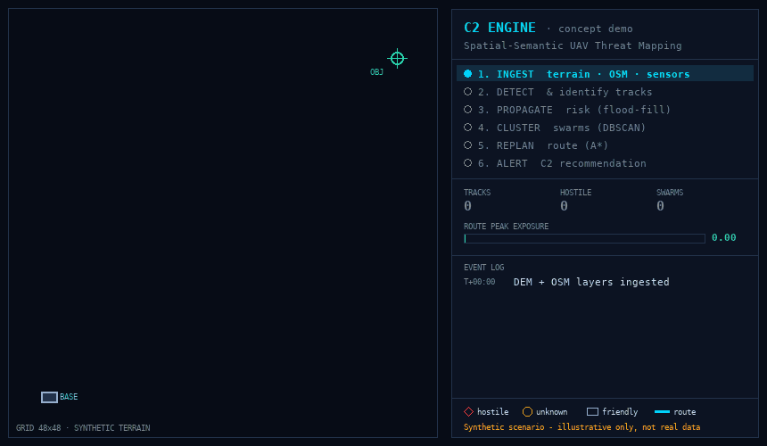

# İHA Tehdit Haritası ve Karar Destek Sistemi

### UAV Threat Map and Decision Support System — Real Data Sources

*ESC 491/492 interdisciplinary senior design project · METU Northern Cyprus Campus · CNG + EEE*


<p align="center">
  
  <br>
  <sub><i>Concept illustration of the C2 engine (detect → propagate risk → replan route). Synthetic scenario — not real data.<br>Sistemin çalışma mantığını gösteren temsili animasyon: dron tespit edilir, tehlikeli bölge belirlenir, rota güvenli yöne çevrilir. Gerçek veri değildir.</i></sub>
</p>

> A curated, evidence-based catalog of **real, citable, and — wherever possible — openly accessible** datasets and literature underpinning a NATO/C4ISR-themed senior capstone project: a **Spatial-Semantic UAV/Drone Threat Mapping & C2 Engine** for tactical field operations.

This repository exists because a good architecture is not enough — a defensible engineering project needs **evidence it can stand on**. Every entry below is a real, external, independently verifiable source: a dataset, a government report, a peer-reviewed measurement, or a standards library. Nothing here is fabricated, assumed, or synthetically generated without grounding.

> 🇹🇷 **Proje hakkında:** Bu proje, sahada İHA/dron tehditlerini harita üzerinde gösteren ve operatöre ne yapması gerektiği konusunda öneri sunan bir **karar destek sistemi**dir. Bu repo ise sistemin dayandığı **gerçek ve doğrulanabilir veri kaynaklarını** bir araya getirir: harita verileri, dron tespit veri setleri, askeri doktrin belgeleri ve bilimsel makaleler. Buradaki hiçbir bilgi uydurma değildir; her kaynağın bağlantısı, lisansı ve erişim durumu belirtilmiştir.

---

## System Architecture → Data Mapping

| Layer | Purpose | Primary Real Data Sources |
|---|---|---|
| **1. Geospatial & Sensor Ingestion** | Terrain, road/building context, baseline air traffic, real UAV detection sensor data, real incident geolocations, team-recorded field data | Copernicus DEM, AW3D30, OpenStreetMap, OpenSky Network, DUT Anti-UAV, UAVSwarm, MMAUD, Halmstad, DroneRF, FAA Sightings, ACLED, mast sensor node recordings |
| **2. Semantic Threat Knowledge Base** | Doctrine/TTP corpus for RAG-based threat reasoning | ATP 3-01.81, DoD C-UAS Strategy, RAND, CNAS, RUSI, ISW, NATO releases |
| **3. Grid/Graph Algorithm Engine** | Risk propagation & route-planning validated against published methods | Peer-reviewed A\*/terrain-masking/threat-cost literature |
| **4. Fusion & C2 Decision Layer** | Quantitative justification for sensor fusion over radar-only detection | Measured radar cross-section (RCS) literature |
| **5. Visualization** | Standards-compliant tactical symbology | MIL-STD-2525 / STANAG APP-6 via milsymbol.js |

Full detail for each layer lives in [`/layers`](./layers).

> 🇹🇷 **Sistem 5 katmandan oluşur:**
> 1. **Harita ve sensör verileri** — arazi, yollar, hava trafiği ve dron tespit kayıtları
> 2. **Tehdit bilgi bankası** — dronlarla ilgili resmi doktrin ve analiz raporları
> 3. **Risk ve rota hesaplama** — tehlikeli bölgeleri belirleyip güvenli rota bulma
> 4. **Veri birleştirme ve karar** — farklı sensörlerden gelen bilgileri birleştirip öneri üretme
> 5. **Görselleştirme** — sonuçları standart askeri sembollerle harita üzerinde gösterme

---

## Access Status Legend

| Badge | Meaning |
|---|---|
| 🟢 **Open** | Freely downloadable, no registration |
| 🟡 **Open + Conditional** | Accessible, but carries a license condition (NC, share-alike, attribution) |
| 🔴 **Gated** | Requires registration, approval, or a signed Data Use Agreement |
| ⚫ **Unverified** | Referenced in literature but no accessible public source found — **do not use** |
| ✅ **Personally Verified** | Downloaded/accessed directly by the project team |

Full legend and notes: [`/docs/legend.md`](./docs/legend.md)

> 🇹🇷 **Renkler ne anlama geliyor?** 🟢 serbestçe indirilebilir · 🟡 erişilebilir ama lisans şartı var · 🔴 kayıt veya izin gerekir · ⚫ doğrulanamadı, kullanılmıyor · ✅ ekibimiz tarafından bizzat erişilip denendi

---

## Quick Stats

```
Total sources catalogued:     35+
Fully open (🟢):               22
Open with conditions (🟡):      8
Gated / registration (🔴):      5
Personally verified (✅):       15 (and growing)
Unverifiable / excluded (⚫):    1
```

---

## Repository Structure

```
uav-cuas-datasets/
├── README.md                                  ← you are here
├── LICENSE
├── assets/
│   └── demo-threat-map.gif
├── layers/
│   ├── 01-geospatial-sensor-data.md
│   ├── 02-semantic-threat-knowledge-base.md
│   ├── 03-algorithm-validation-literature.md
│   ├── 04-radar-cross-section-justification.md
│   └── 05-visualization-standards.md
└── docs/
    ├── proposal/
    │   └── ESC-491-Proposal-2026-10-01.docx
    ├── pilot-region/                          ← pilot region proposals (Eindhoven, Gatwick, Aalborg, Akrotiri) & comparison
    ├── hardware/                              ← accepted procurement list & demo setup
    ├── diagrams/                              ← UML diagrams (use case, deployment, activity)
    ├── computational-model/                   ← sub-models M0–M7, inputs, parameters, validation plan
    ├── design-review/                         ← architecture and data review (12 Nov 2026, proposals)
    ├── progress-report/                       ← ESC 491 First Progress Report
    ├── team-plan.md                           ← task distribution & semester plan (first plan, 15 Oct 2026)
    ├── legend.md
    ├── verified-access-log.md
    └── excluded-sources.md
```

---

## Project Context

- **Project:** UAV Threat Map and Decision Support System (İHA Tehdit Haritası ve Karar Destek Sistemi)
- **Course:** ESC 491 / ESC 492 — interdisciplinary senior design, METU Northern Cyprus Campus
- **Programs:** Computer Engineering (CNG) and Electrical & Electronics Engineering (EEE)
- **Team:** 5 students — 4 CNG, 1 EEE
- **Supervisors:**
  - [Asst. Prof. Dr. Meryem Erbilek](https://avesis.ncc.metu.edu.tr/merbilek) — Computer Engineering (CNG)
  - [Dr. Muhammad Sohail](https://avesis.ncc.metu.edu.tr/msohail) — Electrical & Electronics Engineering (EEE)
- **Theme:** NATO / C4ISR-aligned counter-UAS decision support
- **Proposal:** [ESC 491/492 project proposal (revised after advisor meeting, 1 Oct 2026)](./docs/proposal/ESC-491-Proposal-2026-10-01.docx)

### Team & Roles

| Member | Focus | Main work |
|---|---|---|
| Adil Mert İş (EEE) | Sensor node & RF sensing | IP camera node hardware, power and data links, Wi-Fi/RF control-link detection, detection-range model; joint design of the physical demo and project-wide integration |
| Yaren Duyan (CNG) | Geospatial risk engine | PostGIS terrain + OSM model, grid risk propagation, terrain masking, A\*/Dijkstra safe routes |
| Aydan Doğan (CNG) | Visual detection & tracking | UAV detection on the IP camera stream, multi-target and swarm tracking, OpenSky baseline anomalies |
| Yağız Akkaya (CNG) | Threat knowledge base | RAG over unclassified doctrine, LLM (via API for the demo), mandatory source citation |
| Mert Gökalp (CNG) | Fusion, C2 engine & interface | Composite threat score, recommendations, web C2 map with MIL-STD-2525 symbols |

### Physical Demonstration

The system will be demonstrated **physically**, not only in simulation. Current setup (Nov 2026, accepted by the supervisors):

- **One fixed PoE IP camera** (4 MP, motorized 2.8–12 mm varifocal) on a tripod at the edge of a ~15 m × 17 m outdoor area next to Academic Hall 1
- **All processing on a laptop**: visual detection, risk engine and C2 interface; the LLM is called through an API for the demo
- A **mock drone** carrying an **ESP32 Wi-Fi transmitter**; a second ESP32 on the laptop confirms the drone by detecting a change from the normal Wi-Fi background of the area, while the camera provides its position. MAC addresses are not used anywhere in the system (decision of 12 Nov 2026)
- Detections are mapped on the **pilot-region terrain model** and explained on the operator interface in real time

The multi-node design in the proposal is kept as the scaling path in the report; the demo uses a single node. Details, procurement list and scope assumptions: [`docs/hardware/`](./docs/hardware/). Pilot region candidates (not yet decided): [`docs/pilot-region/`](./docs/pilot-region/).

Detection models are trained and evaluated on the public datasets in [`/layers`](./layers); the field recordings from the demo are logged as **team-collected data** (see Layer 1, section 1.5).

> 🇹🇷 **Ekip ve demo:** 4 CNG + 1 EEE öğrencisinden oluşan disiplinlerarası bir ESC 491/492 projesidir (danışmanlar: Meryem Erbilek — CNG, Muhammad Sohail — EEE). Demo fiziksel olarak yapılacak: tek bir IP kamera ve dizüstü bilgisayar, ESP32 verici taşıyan bir maket drone'u hem görüntüden hem Wi-Fi sinyalinden tespit edecek ve sonuç canlı olarak harita arayüzünde gösterilecek.

---

## Project at a Glance

The most important tables from the project documents, in one place. Each table links to the full document.

### Pilot region candidates

Four candidates, compared on 7–8 Nov 2026. **The team has not decided yet.** Full table, sources and data tests: [`docs/pilot-region/comparison.md`](./docs/pilot-region/comparison.md).

| Criterion | Eindhoven (NL) | Gatwick (UK) | Aalborg (DK) | Akrotiri / Chania, Crete (GR) |
|---|---|---|---|---|
| Proposed by | Yağız Akkaya | Yaren Duyan | Aydan Doğan | Mert Gökalp |
| Facility / NATO theme | Joint civil–military airfield | Civil airport only | Joint civil–military airfield | Chania Airport, NSA Souda Bay, NAMFI range |
| Drone incident | 22 Nov 2025 closure, C-UAS activated | Dec 2018, ~30–33 h closure | 24–25 Sep 2025, ~3 h closure | None found (only exercise target drones at NAMFI) |
| Terrain | AHN 0.5 m DSM/DTM | EA 1 m DSM/DTM | DHM 0.4 m (download needs a free token) | Copernicus 30 m, hilly (0–517 m) |
| Building heights | 3DBAG, measured for every building | Derive from DSM − DTM | None; derive from DHM | None; estimated by building type |
| Drone restriction zones | No open source left (PDOK / LVNL API retired 30 Jun 2026); 3 km runway buffer used as an assumption | NATS UAS zones, downloaded | Map only, no reusable data | Web map only |
| Data access test | Done (8 Nov): 11 of 15 sources passed | Partly (7 Nov) | Partly (7 Nov) | Partly (8 Nov), GeoPackage + sample line of sight |
| Main strength | Building data and incident record | Restriction-zone data and peer-reviewed literature | Link to visual detection (night incident, Halmstad dataset) | Hilly terrain for line-of-sight analysis |

### Hardware request (accepted by the supervisors)

10 items, total **₺10,088**. Full list with links, assumptions and follow-ups: [`docs/hardware/`](./docs/hardware/).

| # | Component | Qty | Total |
|---:|---|---:|---:|
| 1 | Hikvision DS-2CD1643G2-LIZSU PoE IP camera (4 MP, 2.8–12 mm motorized lens) | 1 | ₺5,200 |
| 2 | ESP32 development board (receiver + mock-drone transmitter) | 2 | ₺840 |
| 3 | USB data cable for ESP32 | 1 | ₺48 |
| 4 | 10,000 mAh power bank (mock drone) | 1 | ₺679 |
| 5 | Cat6 outdoor Ethernet cable, ~30 m | 1 | ₺750 |
| 6 | Cat6 patch cable, 1–2 m | 1 | ₺170 |
| 7 | PoE injector (IEEE 802.3af, gigabit) | 1 | ₺780 |
| 8 | 12 V 1 A power adapter (backup camera power) | 1 | ₺250 |
| 9 | Tripod or fixed mounting bracket | 1 | ₺1,099.90 |
| 10 | Mounting and wiring accessories | 1 set | ₺271 |
| | **Total** | | **₺10,088** |

The laptop (RTX 4070), mock drone and 3D printer are provided by the team.

### Task distribution

From the first semester plan (15 Oct 2026). Full plan with the 14-week schedule: [`docs/team-plan.md`](./docs/team-plan.md).

| Person | Primary (owned layer) | Secondary task |
|---|---|---|
| Adil Mert İş (EEE) | Sensor node hardware + Wi-Fi/RF control-link detection (Layer 1, sensor part) | Detection range / link budget model and RCS justification (Layer 4); field test lead |
| Yaren Duyan | Terrain + OSM model, grid risk propagation, line of sight, A\*/Dijkstra routing (Layers 1 and 3) | Risk model validation with FAA/ACLED records; map layers for the C2 interface |
| Aydan Doğan | Camera-based detection and swarm tracking (Layer 1, vision part) | Recording and labelling the team's own field dataset |
| Yağız Akkaya | Doctrine knowledge base, RAG + LLM, mandatory citations (Layer 2) | Test scenarios and evaluation metrics; report editor |
| Mert Gökalp | Fusion, threat score, recommendation engine, C2 web interface (Layers 4 and 5) | System architecture, interface contracts, mock data simulator; integration lead |

| Week | Deliverable | Owner |
|---|---|---|
| 3 | Interface contracts (JSON schemas) and hardware order | Mert Gökalp, Adil Mert İş |
| 6 | Every layer runs on its own with mock data | Everyone |
| 8 | Interim report / progress presentation | Yağız Akkaya (editor), everyone their own chapter |
| 9 | End-to-end demo with recorded data (desk) | Mert Gökalp |
| 12 | Live detection with a single node in the field, shown on the map | Adil Mert İş, Aydan Doğan |
| 14 | Final report, presentation, demo v1 | Everyone |

### Design review

A review of the architecture, the pilot-region choice and data adequacy (12 Nov 2026) lists open design issues and proposed fixes: [`docs/design-review/`](./docs/design-review/architecture-review-2026-11-12.md). The items are proposals until the team and supervisors agree.

### System diagrams

UML diagrams of the demo system. All diagrams with previews: [`docs/diagrams/`](./docs/diagrams/).

| Diagram | Author | File |
|---|---|---|
| Use case | Aydan Doğan | [use-case-diagram.png](./docs/diagrams/Diagrams-Aydan%20Do%C4%9Fan/use-case-diagram.png) |
| Deployment | Aydan Doğan | [deployment-diagram.jpeg](./docs/diagrams/Diagrams-Aydan%20Do%C4%9Fan/deployment-diagram.jpeg) |
| Activity (detection to decision) | Aydan Doğan | [activity-diagram.jpeg](./docs/diagrams/Diagrams-Aydan%20Do%C4%9Fan/activity-diagram.jpeg) |

---

## Contributing (Internal Team Use)

Found a new real dataset or source? Add it to the relevant file in [`/layers`](./layers) using the template at the bottom of that file, then update the Quick Stats count above.

---

## License

The **curation, structure, and commentary** in this repository are released under [CC0 1.0](./LICENSE) — free to reuse for academic purposes. Each *linked* dataset or document retains **its own original license**, as noted per entry. Always check the source's license before redistributing or using it commercially.

> 🇹🇷 Bu repodaki derleme ve açıklamalar serbestçe kullanılabilir. Bağlantı verilen veri setleri ve belgeler ise kendi lisanslarına tabidir.
