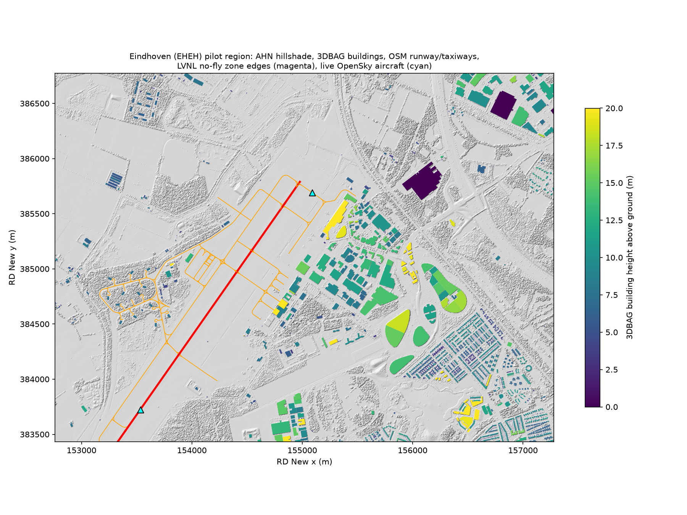

# Eindhoven: Region-Selection Brief

*Yağız Akkaya, 8 November 2026. One-page summary for the pilot-region meeting. Details: [proposal](./eindhoven-proposal.md) · [sources](./eindhoven-sources-and-data-test.md) · [literature review](./eindhoven-literature-review.md) · [local data test](./local-data-test/results/data-test-report.md) · [four-region comparison](../comparison.md).*

## The case in four points

1. **Real, recent, documented incident.** On 22 November 2025 all civil and military flights at Eindhoven were halted for about two hours after drone sightings, with Defence counter-drone systems on standby. It is recorded in parliament (Kamerstuk 36 858 no. 6) and analysed in the IISS report *Russia's UAV Campaign Over Europe* (July 2026).
2. **Joint civil–military airfield.** It fits the NATO / C4ISR theme without being a purely military site.
3. **Best open data of the four candidates, now downloaded, not just catalogued.** On 8 November the whole AOI was downloaded on a team laptop with a reproducible script:
   - AHN 0.5 m surface and terrain model (9036 × 6676 px, CC0)
   - 3DBAG: 3,472 buildings with LiDAR-measured heights (CC BY 4.0), which no other candidate has
   - OpenStreetMap airport layout: runways, 113 taxiways, 25 hangars, terminal, tower
   - OpenSky live traffic
4. **Peer-reviewed backing for the method and data.** Multi-sensor detection and the limits on mitigation at airports (Lykou et al., *Sensors* 2020); 3DBAG accuracy, with error under 31 cm for 95 % of buildings (Peters et al., *PE&RS* 2022); OpenSky as the traffic baseline (Schäfer et al., *IPSN* 2014).

## Honest weaknesses

| Weakness | Impact | Plan |
|---|---|---|
| PDOK/LVNL drone no-fly-zone API retired on 30 June 2026 | The restricted-zone layer has no open API any more | Use the current official ED-269 zone file if one can be found; otherwise digitise the EHEH control zone from the public map, or model it as a runway buffer and state the assumption |
| OpenSky history needs an account | The traffic gap on the incident night is not yet shown | Create a free OpenSky API client and rerun one script |
| No peer-reviewed paper on the incident itself | Incident evidence relies on parliament, news and IISS | Same for every candidate except Gatwick; Gatwick is cited for motivation |
| Real military co-located site | Vulnerability outputs must stay out of the public repo | Only open data and aggregate checks are published |

## How it compares (short)

| | Eindhoven | Gatwick | Aalborg | Akrotiri |
|---|---|---|---|---|
| Civil–military | ✅ | ❌ | ✅ | ✅ |
| Drone incident | ✅ 2025 | ✅ 2018 | ✅ 2025 | ❌ |
| Building heights | ✅ measured (3DBAG) | derive from DSM | derive from DSM | estimated |
| Terrain resolution | 0.5 m | 1 m | 0.4 m (token needed) | 30 m |
| Restriction zones | ⚠️ API retired | ✅ NATS file | ⚠️ map only | ⚠️ map only |
| Data downloaded end to end | ✅ 4 of 6 layers | partly | partly | ✅ processed |

## Proposal for the meeting

Choose **Eindhoven** as the pilot region, use **Gatwick 2018** in the introduction as motivation, and keep **Aalborg** as the backup, since it has the same civil–military profile. The first two follow-up tasks are a replacement source for the no-fly-zone layer and an OpenSky account for the incident-night traffic check.
