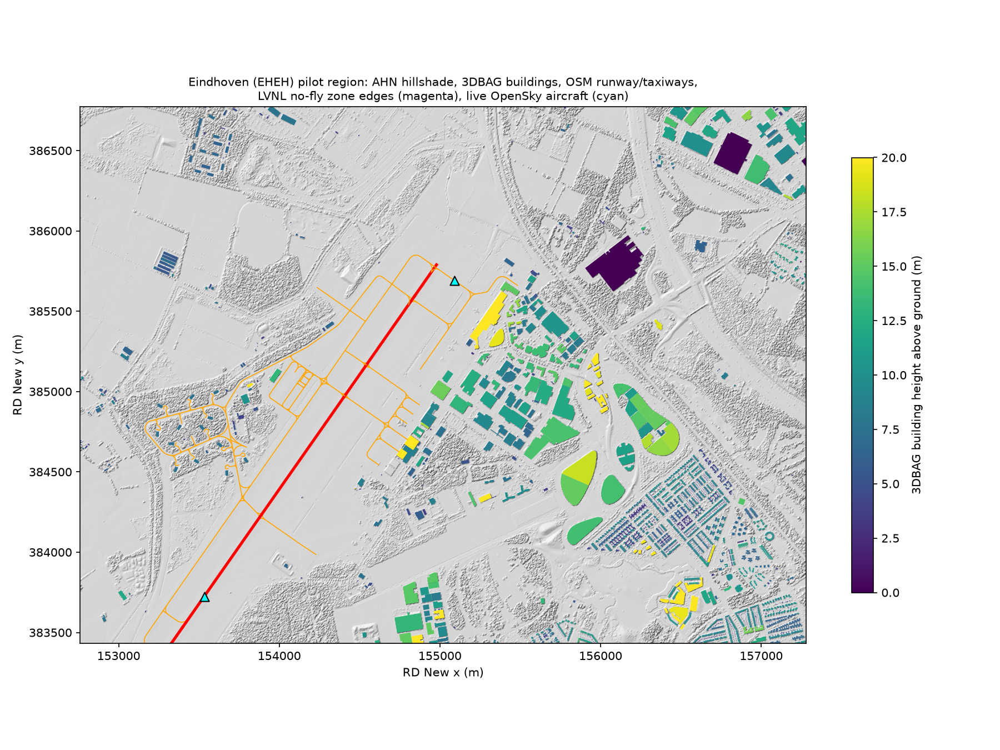

# Eindhoven Local Data Test

*Yağız Akkaya, 8 November 2026.*

A small, reproducible Python project that downloads every open dataset the decision engine needs for the Eindhoven pilot region and records whether each source really works. The earlier test ([`../eindhoven-sources-and-data-test.md`](../eindhoven-sources-and-data-test.md)) only checked catalogues and landing pages through a remote tool; this one downloads the data itself on a team laptop.

## Area

- AOI: `5.355, 51.440, 5.420, 51.470` (WGS84) = `152761, 383434, 157279, 386772` (RD New, EPSG:28992), about 4.5 × 3.3 km around the EHEH runway.
- Airspace context box (no-fly zones are larger than the AOI): `5.20, 51.36, 5.58, 51.56`.

## What each script does

| Script | Source | Output (in `data/`, not committed) |
|---|---|---|
| `01_ahn.py` | AHN 0.5 m DSM and DTM, PDOK WCS, CC0 | `ahn/dsm_05m.tif`, `ahn/dtm_05m.tif` (1 km tiles mosaicked) |
| `02_3dbag.py` | 3DBAG API, CC BY 4.0 | `3dbag/buildings.geojson` (footprint + roof/ground height per building) |
| `03_nofly.py` | LVNL drone no-fly zones, PDOK OGC API, PDM 1.0 | `nofly/<collection>.geojson` |
| `04_osm.py` | OpenStreetMap via Overpass, ODbL | `osm/osm.geojson` (aeroway, buildings, roads, land use) |
| `05_opensky.py` | OpenSky Network | `opensky/live_states.json`, arrivals/departures for 22 Nov 2025 and 15 Nov 2025 |
| `06_summary.py` | all of the above | `results/eindhoven-data-map.png`, `results/data-test-report.md` |

Every script appends a row to `results/access-log.json` (source, success, detail, time).

## How to run

```bash
python -m venv .venv
.venv\Scripts\activate            # Windows  (Linux/macOS: source .venv/bin/activate)
pip install -r requirements.txt
python run_all.py                 # everything
python run_all.py 03              # only one step
```

OpenSky historical flight lists need a free account. Create an API client on opensky-network.org and set `OPENSKY_CLIENT_ID` and `OPENSKY_CLIENT_SECRET` before running; without them the script records what anonymous access returns.

## Scope

Only open data and data-access checks are produced. No sensor-placement, blind-spot or vulnerability analysis of the air base is published, because the repository is public. Results are in [`results/data-test-report.md`](./results/data-test-report.md).


