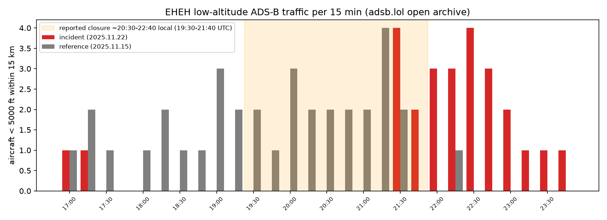
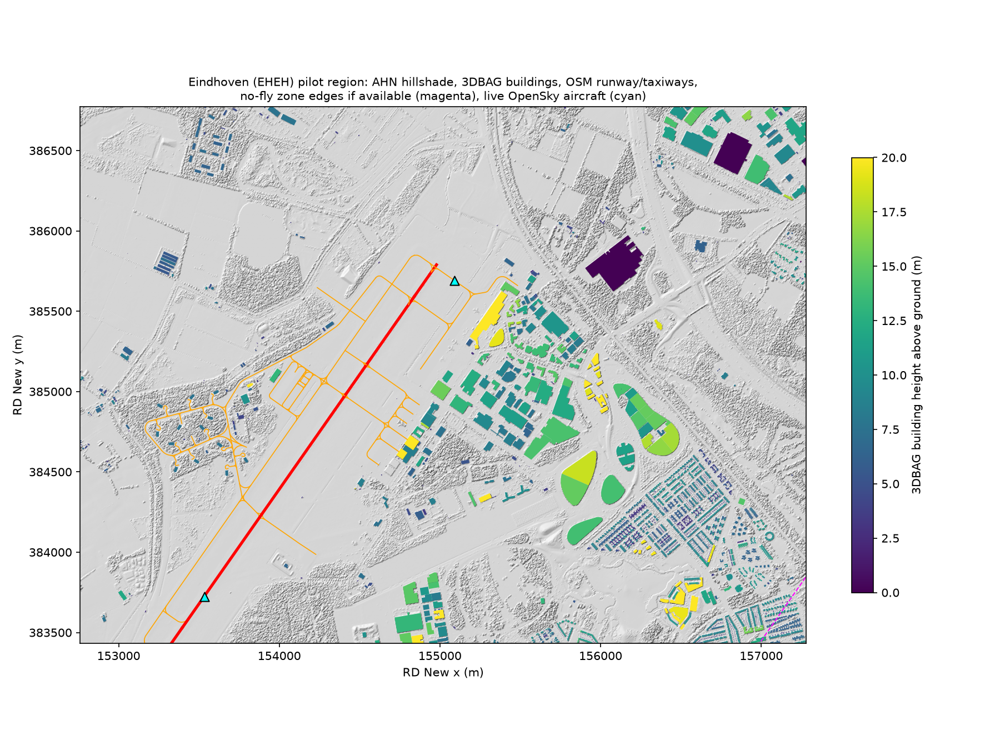

# Eindhoven local data test: results

*Run by Yağız Akkaya on the team laptop (Windows, Python 3.13.7), 8 November 2026: first round 13:43–13:45 UTC, alternative sources 14:20–16:20 UTC. Raw data stays on the laptop in `data/` and is not committed; anyone can reproduce it with `python run_all.py`.*

**15 sources tested: 11 passed, 4 failed.** All four failures are refusals by the server (retired service, paid access or account needed), not script errors.

## 1. Core layers

| Source | Result | Detail | Tested (UTC) |
|---|:---:|---|---|
| AHN WCS (PDOK) | ✅ | DSM + DTM 0.5 m, 40 tiles mosaicked to 9036 × 6676 px (333 MB). Terrain 14.3–38.3 m NAP (mean 20.2), surface max 94.2 m. Valid pixels: DTM 88.5 %, DSM 97.5 % (DTM gaps are under buildings, as expected). | 2026-11-08 13:45 |
| 3DBAG API | ✅ | **3,472 buildings** (70 pages), all with an LoD0 footprint, 3,464 with roof and ground height. Height above ground: mean 6.5 m, max 74.3 m. | 2026-11-08 13:43 |
| OpenStreetMap (Overpass) | ✅ | 8,295 features: 4,015 buildings (only 10 with a height tag), 1,870 road segments; aeroway: 3 runway ways, 113 taxiways, 4 aprons, 25 hangars, 1 tower, 1 terminal, 39 parking positions, 1,086 navigation-aid nodes. | 2026-11-08 13:43 |
| OpenSky live states | ✅ | 2 aircraft in the airport box, anonymous access (RYR4022, WZZ82UE). | 2026-11-08 13:45 |
| OpenSky history (EHEH, 22 Nov 2025) | ❌ | HTTP 403 for all four queries without an account. Replaced by adsb.lol (section 3). | 2026-11-08 13:45 |

## 2. Restricted zones

| Source | Result | Detail | Tested (UTC) |
|---|:---:|---|---|
| PDOK drone no-fly zones (OGC API) | ❌ | HTTP 404. PDOK took the dataset out of production on 30 June 2026 at LVNL's request. | 2026-11-08 13:43 |
| PDOK drone no-fly zones (old WFS) | ❌ | HTTP 404, retired with the OGC API. | 2026-11-08 14:20 |
| openAIP airspace export (NL) | ❌ | HTTP 400 `UserProjectMissing`: the bucket is now requester-pays, so anonymous download is closed; the openAIP API needs a key. | 2026-11-08 14:20 |
| PDOK Defensie aviation obstacle reports | ✅ | API reachable; 0 obstacle reports in the EHEH context box. | 2026-11-08 14:20 |
| OurAirports runways (EHEH) | ✅ | 1 runway, 03/21, 9,843 ft, asphalt, with threshold coordinates. Used to build a **fallback zone: a 3,000 m buffer around the runway centreline. This is a modelling assumption, not an official zone.** | 2026-11-08 14:20 |

Also checked by hand (not scripted): the LVNL eAIP returned 403; GoDrone (LVNL's official map) runs on a commercial platform with no open API; openflightmaps has no Dutch coverage. A trade-press survey (Unmanned Airspace, Sept 2026) reports that what remains is a file frozen at December 2025 with no licence, and GoDrone's terms forbid redistribution. **Conclusion: there is no open, licensed restricted-zone dataset for the Netherlands any more; the engine uses the documented runway buffer.**

## 3. Incident-night air traffic (adsb.lol open archive, ODbL)

| Source | Result | Detail | Tested (UTC) |
|---|:---:|---|---|
| adsb.lol history 2025.11.22 (incident) | ✅ | 3.1 GB day archive, 66,048 aircraft traces scanned; 9 aircraft below 5,000 ft within 15 km of EHEH, 17–24 UTC. | 2026-11-08 16:15 |
| adsb.lol history 2025.11.15 (reference, same weekday) | ✅ | 3.0 GB, 62,531 traces; 13 aircraft in the same filter. | 2026-11-08 16:20 |

**What the data shows:** on 22 November there are **no aircraft below 5,000 ft within 15 km of EHEH from 17:30 to 21:30 UTC**; traffic resumes from 21:30 UTC, including a Dutch Air Force Gulfstream (callsign NAF11, 22:03–22:32 UTC). On the reference evening a week earlier, every 15-minute slot in the same window has 1–4 aircraft.

**How to read it:** the gap covers the reported closure (about 19:30–21:40 UTC) but starts about two hours earlier, which the public timeline does not explain. adsb.lol is a volunteer receiver network, so low-altitude coverage can have holes. The gap is therefore **consistent with** the closure, not proof of it.

## 4. Extra layers and cross-checks

| Source | Result | Detail | Tested (UTC) |
|---|:---:|---|---|
| ESA WorldCover 10 m (2021) | ✅ | 780 × 360 px in the AOI. Land cover: grassland 33.2 %, **tree cover 32.1 %**, built-up 24.4 %, cropland 8.9 %, water 1.2 %, bare 0.2 %. | 2026-11-08 16:20 |
| Copernicus DEM GLO-30 | ✅ | 156 × 108 px in the AOI, surface 10.3–46.3 m (EGM2008). Against the AHN DSM averaged to the same 30 m cells: mean difference −0.17 m, **RMSE 3.27 m, 95th-percentile absolute difference 7.56 m** (NAP/EGM2008 datum offset not removed). | 2026-11-08 16:20 |
| KNMI hourly weather (station 370 Eindhoven) | ✅ | 22 Nov 2025, 18–23 UT: wind from 180° (south) at 5.0 m/s (4.0 m/s at 22–23 UT), temperature 0.6 to −0.3 °C, overcast 8/8, visibility code 83. | 2026-11-08 16:20 |

## Derived checks

- **15.8 %** of the AOI has a surface more than 2.5 m above the terrain (buildings and trees); the 99th-percentile object height is 14.1 m. This DSM − DTM layer is the obstruction input for line of sight.
- **Trees matter:** WorldCover puts tree cover at 32 % of the AOI, and 3DBAG has no trees, so the AHN DSM (not 3DBAG alone) must be used for obstruction.
- **Resolution matters:** a 30 m global model matches AHN on average but differs locally by 3.3 m RMSE and by more than 7.6 m in 5 % of cells, which is the size of a building or tree line. This is the error a 30 m-only region (such as Akrotiri) carries into line-of-sight results.

Only these aggregate checks are published; no sensor-placement or blind-spot analysis of the air base is included.

## Notes

1. **3DBAG count corrected.** The 6 November probe reported 6,946 objects for the same box; the full download gives 3,472 buildings, almost exactly half, so the earlier figure most likely counted building parts as well (inference). Use 3,472.
2. **OpenSky history** can still be added with a free account (`OPENSKY_CLIENT_ID` / `OPENSKY_CLIENT_SECRET`, then `python run_all.py 05`), but adsb.lol already covers the incident night.

## Fixes made while running

- `01_ahn.py`: PDOK tiles use float32-max as nodata; rasterio ≥ 1.5 silently wrote an all-zero mosaic. Fixed with an explicit nodata of −9999.
- `05_opensky.py`: a naive epoch timestamp raised `OSError [Errno 22]` on Windows. Fixed with timezone-aware UTC.
- `08_adsb_history.py`: the adsb.lol archive is now split into one repository per year (`globe_history_2025`).
- `09_extra_layers.py`: GDAL could not open the CA bundle because the folder path contains non-ASCII characters ("İHA … Haritası"); the bundle is copied to an ASCII temp path. The KNMI summary now filters to 22 November (the API returns whole days).

## Overview map

*Magenta dashed line = fallback zone: 3 km buffer around the runway centreline (modelling assumption, not an official zone).*
