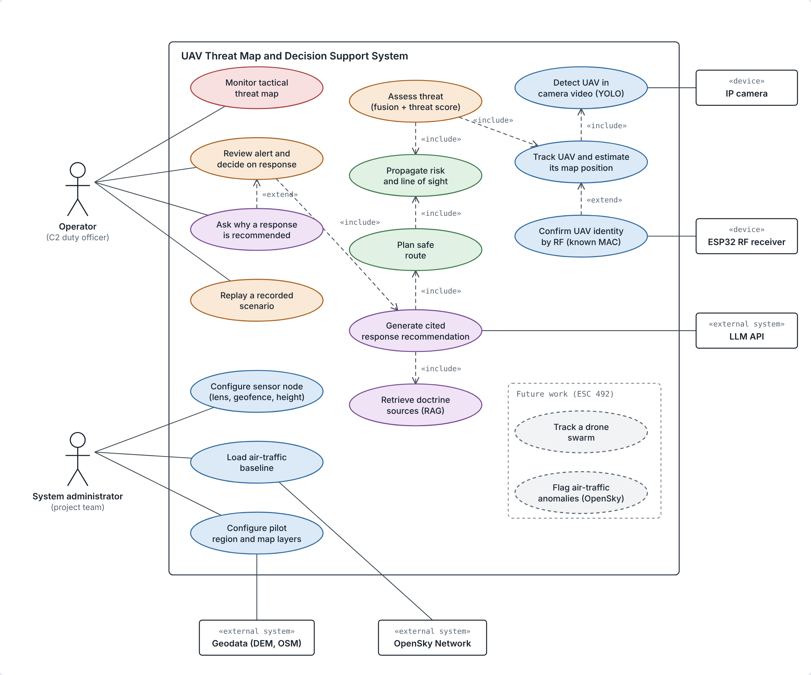
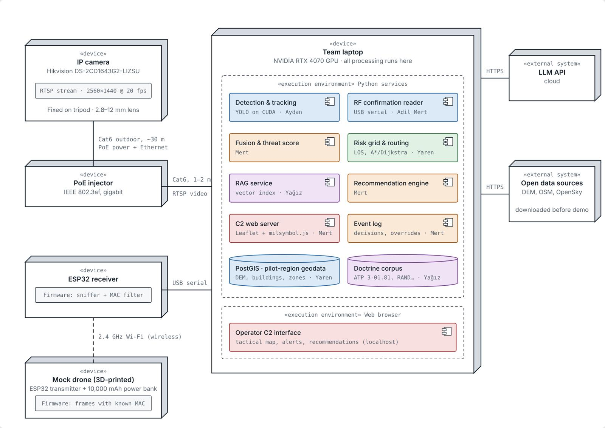
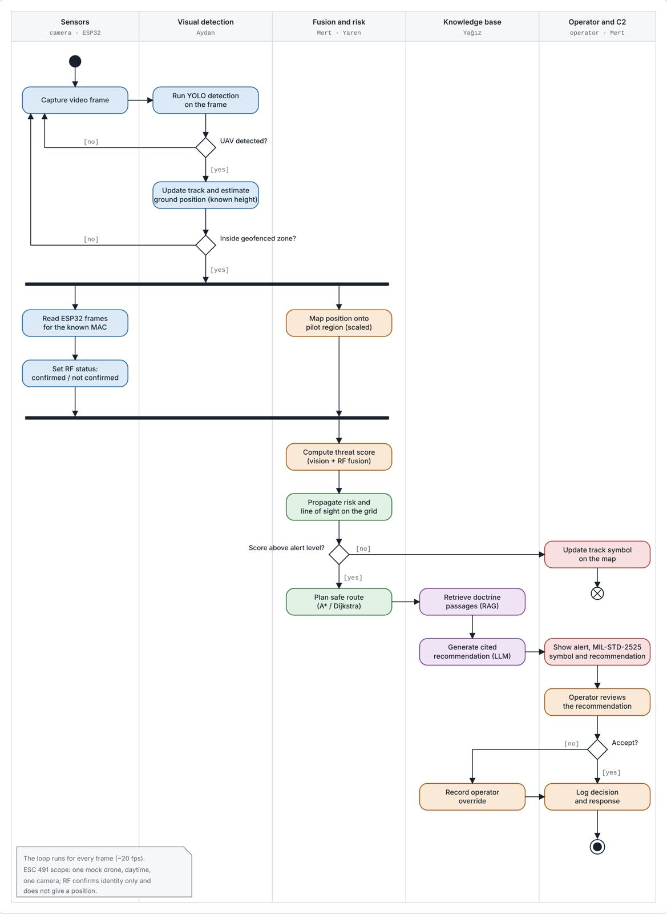

# System Design

**Owner:** Aydan Doğan · **Weight:** 10%

## 6.1 Conceptual design

The system protects a critical site, such as an airfield, against small non-cooperative UAVs. A sensor node detects a drone, the system places it on a map of the site, estimates its threat level and recommends a response with a cited doctrine passage. The **operator** always makes the final decision; the **system administrator** (the team) configures the sensor and the pilot region. External systems are open geodata, the OpenSky Network and a language-model API (Figure 6.1).

The system is a chain of five layers:

| Layer | Question it answers | Output |
|---|---|---|
| 1. Sensing and detection | Is there a drone, and where? | Tracks (camera), identity confirmation (RF) |
| 2. Knowledge base | What does doctrine say? | Cited doctrine passages |
| 3. Geospatial risk | Which areas are exposed? | Risk grid, line of sight, safe route |
| 4. Fusion and threat assessment | How dangerous is it? | Threat score and level |
| 5. Decision support and C2 | What should the operator do? | MIL-STD-2525 map, alert, cited recommendation |

**Design principles:** every recommendation cites its source and the language model only explains a rule-based decision; the operator accepts or overrides every recommendation and nothing is acted on automatically; all data are open and citable; layers communicate only through defined messages; the design scales by adding cameras that run the same process.

**Main design decisions** (agreed with the supervisors to keep the system simple and low-cost): one fixed PoE IP camera instead of four Jetson nodes; all processing on a team laptop (RTX 4070) instead of edge boards; the language model through an API instead of locally; a 3D-printed mock drone with an ESP32 transmitter instead of a real drone; RF used only to confirm identity by MAC address; ground position from one camera and a known flight height. The ESC 491 demo covers one drone, daytime, clear weather and a ~15–20 m geofenced flight zone.

## 6.2 Preliminary design

**Hardware (Figure 6.2).** A Hikvision DS-2CD1643G2-LIZSU camera on a tripod sends video and receives power over a ~30 m Cat6 cable through a PoE injector to the laptop (RTSP, 2560 × 1440 at 20 fps). An ESP32 receiver connects over USB; the mock drone carries a second ESP32 and a power bank. Total procurement cost is ₺10,088.

**Software subsystems** (all on the laptop):

| Subsystem | Output | Owner |
|---|---|---|
| Visual detection and tracking (YOLO on CUDA) | Track ID, ground position | Aydan Doğan |
| RF confirmation (ESP32 sniffer, MAC filter) | Confirmed / not confirmed | Adil Mert İş |
| Risk grid and routing (PostGIS, line of sight, A\*) | Risk grid, safe route | Yaren Duyan |
| Knowledge base (RAG, LLM API) | Cited explanation | Yağız Akkaya |
| Fusion, threat score, C2 interface (Leaflet, milsymbol.js) | Threat level, alert, decision log | Mert Gökalp |

**Processing flow (Figure 6.3).** Each frame is checked for a UAV; a detected drone's track and ground position are updated and checked against the geofence. In parallel the RF status is set and the position is mapped onto the pilot region with a scaled transformation. Fusion computes the threat score and the risk is propagated on the grid. Below the alert level only the map symbol is updated; above it, a safe route is planned, doctrine is retrieved and a cited recommendation is shown to the operator, whose decision or override is logged.

ESC 492 extends this structure with more cameras, fine-tuning on field recordings, swarm tracking and OpenSky anomaly detection.
