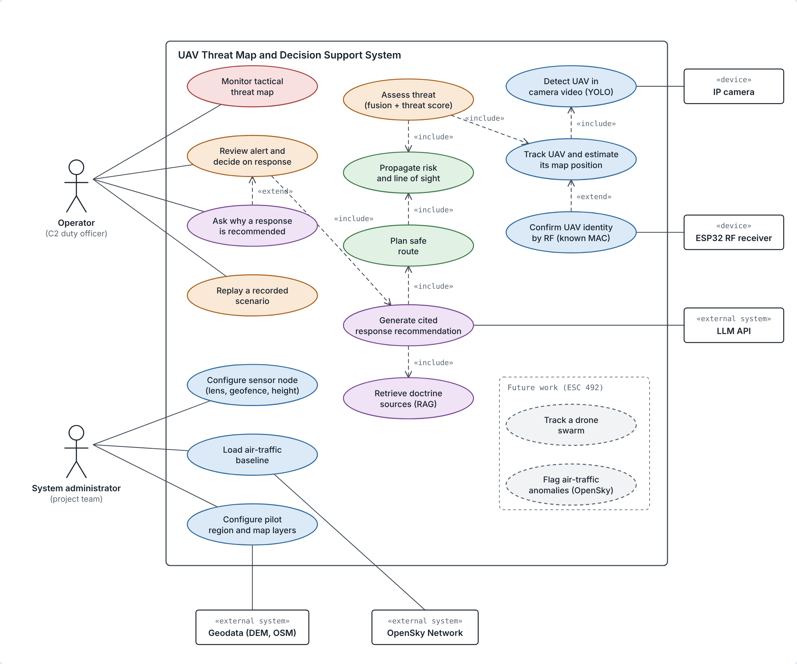
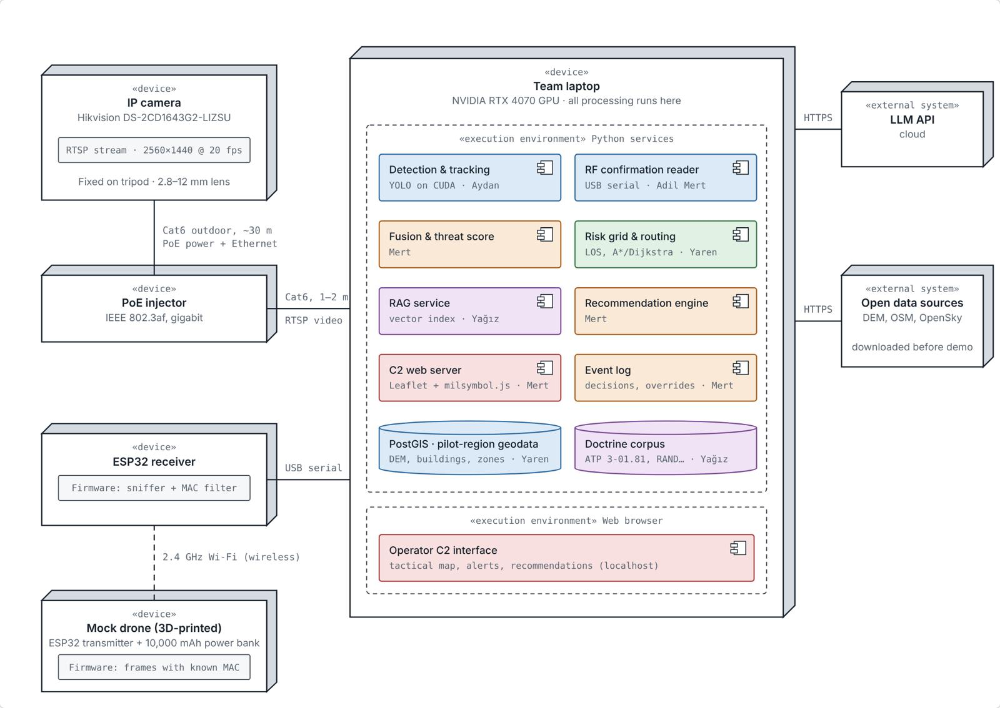
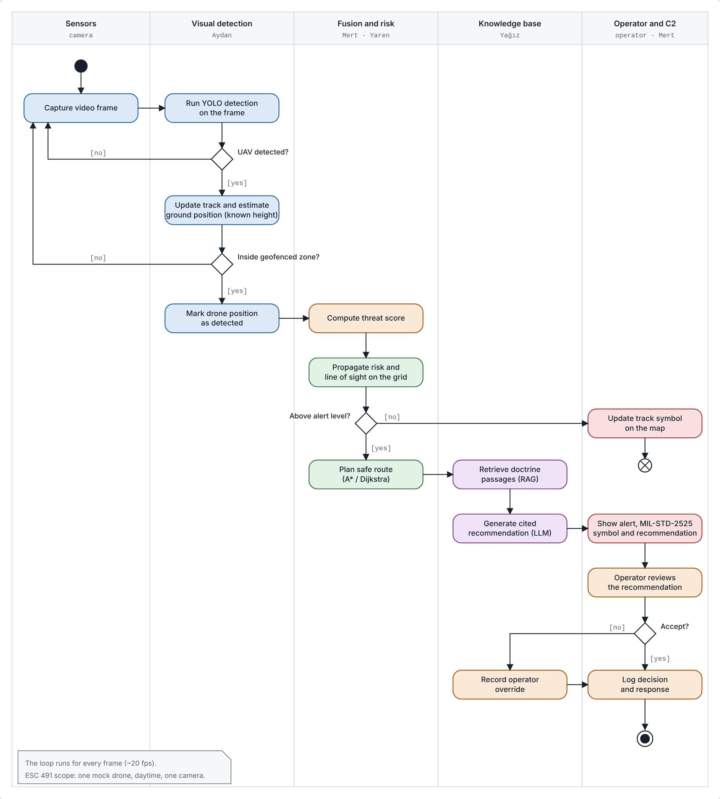

# UAV Threat Map and Decision Support System

**ESC 491 – First Progress Report**

12 November 2026

**Supervisors:** Dr. Meryem Erbilek, Dr. Muhammad Sohail

**Group members:** Yaren Duyan, Aydan Doğan, Mert Gökalp, Yağız Akkaya, Adil Mert İş

---

## Table of contents

- [1 Overview (Executive Summary)](#1-overview-executive-summary)
- [2 Introduction](#2-introduction)
  - [2.1 Statement of the problem](#21-statement-of-the-problem)
  - [2.2 Aim and objectives](#22-aim-and-objectives)
- [3 Literature Review](#3-literature-review)
  - [3.1 Theoretical background](#31-theoretical-background)
  - [3.2 Previous work](#32-previous-work)
  - [3.3 Summary and research gap](#33-summary-and-research-gap)
- [4 Requirement Specifications](#4-requirement-specifications)
  - [4.1 Functional requirements](#41-functional-requirements)
  - [4.2 Non-functional requirements](#42-non-functional-requirements)
  - [4.3 Domain requirements](#43-domain-requirements)
- [5 Research Method](#5-research-method)
  - [5.1 Selected method and reasons](#51-selected-method-and-reasons)
  - [5.2 Implementation](#52-implementation)
  - [5.3 Testing and validation](#53-testing-and-validation)
- [6 System Design](#6-system-design)
  - [6.1 Conceptual design](#61-conceptual-design)
  - [6.2 Preliminary design](#62-preliminary-design)
- [7 Conclusion](#7-conclusion)
  - [7.1 Progress so far](#71-progress-so-far)
  - [7.2 Difficulties faced](#72-difficulties-faced)
  - [7.3 Retrospective](#73-retrospective)
- [References](#references)

---

## 1 Overview (Executive Summary)

This report presents the progress of the UAV Threat Map and Decision Support System, an ESC 491 project carried out by four Computer Engineering students and one Electrical and Electronics Engineering student. Small commercial drones have become a real threat to airports, military sites and other critical facilities. Detecting them is difficult, and once one has been detected, an operator still has to decide quickly how dangerous it is and what to do. The project aims to build a system that turns UAV detections into a live, explainable threat picture of a protected site and recommends a response that the operator can verify against published doctrine.

The report first states the problem and the project's aim and objectives. It then reviews the literature on drone incidents and detection sensors, map data, academic studies and datasets, doctrine, and Turkish counter-drone systems, ending with a comparison that identifies the research gap. It also specifies the functional, non-functional and domain requirements of the system. The research method follows the Design Science Research Methodology with iterative prototyping in five phases: each module is first developed against mock data and public datasets, then integrated on recorded data, and finally tested live on campus. The system design is presented as a five-layer architecture with activity and deployment diagrams; the use case diagram is given with the requirements. Following the supervisors' guidance, the physical demonstration has been narrowed to a single fixed IP camera, an ESP32-based 2.4 GHz Wi-Fi receiver and a laptop. The report closes with the difficulties faced so far, mainly the changes in hardware scope and the still open choice of pilot region, and with a retrospective on the team's work.

## 2 Introduction

### 2.1 Statement of the problem

#### 2.1.1 What

Small commercial drones are cheap, easy to buy and hard to see. Over the past decade they have gone from a hobbyist curiosity to a real security problem for airports, military bases and other critical sites. When one appears near such a site, the people protecting it have to answer three questions quickly: is it really a drone, how dangerous is it, and what should we do about it? This project tries to answer all three. A deep-learning detector recognises the drone in a camera image, and its Wi-Fi signal confirms its identity. The system then places it on a real terrain model of the protected site, estimates how threatening it is, and recommends a response that the operator can check against published doctrine.

#### 2.1.2 Why

The problem is no longer hypothetical. In December 2018 drone sightings closed London Gatwick for more than a day [1]. On 22 November 2025, civil and military flights at Eindhoven were halted for about two hours after drones were reported near the airfield [2], and an IISS study counted 144 drone incidents across 13 European countries between August 2024 and February 2026 [3]. In the United States, the FAA has collected more than 20,000 sighting reports since 2014 [4], and in 2026 NATO approved a multi-year, multi-billion-dollar counter-drone initiative [5].

Detecting these aircraft is hard. Small drones have radar cross-sections well below 0 dBsm, so radar alone often misses them [6], and studies of airport protection recommend combining several types of sensors rather than relying on one [7]. Detection, however, is only half of the job. Once a track appears, an operator still has to judge, usually within seconds, which assets are exposed, whether the terrain hides the drone's approach, and which procedure applies. Most counter-UAS products put their effort into the sensors and effectors: radar, RF, electro-optical and acoustic detection, and jamming or interception. As far as we can tell from public documentation, their command-and-control software fuses tracks and assigns effectors, but it does not explain why a track is dangerous in terms of the terrain, the protected assets and doctrine. Türkiye's national UAV traffic platform İHATTYS manages registered, cooperative drones [8]; a drone that does not announce itself is outside its scope by definition. This is the gap we want to address: an explainable layer between "a drone has been detected" and "this is what to do". The project does not build radar sensing or any means of neutralising a drone; it uses a camera and a 2.4 GHz Wi-Fi receiver for detection and concentrates on assessment and decision support. Terrain effects such as line of sight are computed on the terrain model of the pilot region, onto which the detections from the flat campus demo area are mapped.

#### 2.1.3 How

The system has five parts, each owned by one team member:

- A camera node detects the drone in an IP camera stream with a deep-learning detector.
- A 2.4 GHz Wi-Fi receiver confirms the drone's identity from its signal.
- A geospatial engine places the track on a terrain and building model of the site, spreads its risk over a grid while taking line of sight into account, and computes safe routes.
- A knowledge base uses retrieval-augmented generation [9] to find relevant passages in unclassified counter-UAS doctrine such as ATP 3-01.81 [10].
- A fusion and command-and-control layer combines the camera and Wi-Fi evidence into a single threat score. It shows the result on a web map with MIL-STD-2525 symbols [11], together with a recommendation that cites the document and page it is based on.

The whole system is built on real, openly available data instead of invented inputs: terrain models, OpenStreetMap, OpenSky air traffic and public drone datasets [12]–[17]. Every source is catalogued in the project repository [18].

The system will be demonstrated physically on campus. For ESC 491, after discussions with our supervisors, the setup has been deliberately kept small:

- One fixed PoE IP camera on a tripod watches an area of roughly 15 m × 17 m next to Academic Hall 1.
- All processing runs on a single laptop, and the language model is accessed through an API.
- A 3D-printed mock drone carrying an ESP32 transmitter plays the intruder.

The original multi-node design stays in the report as the way the system would scale, since each additional camera simply runs the same pipeline in parallel, but it will not be built in this course. Detections from the demo area will be shown on the terrain model of a pilot region. Four candidates (Eindhoven, Gatwick, Aalborg and Akrotiri/Chania) are being compared, and the final choice has not yet been made.

### 2.2 Aim and objectives

**Aim:** To design and demonstrate a decision-support system that turns UAV detections into a live, explainable threat picture of a protected site and recommends a response the operator can verify.

**Objectives:**

1. Detect a single mock UAV in the camera stream in daylight and estimate its ground position from a known flight height, within a detection range and latency to be agreed with the supervisors.
2. Confirm the drone's presence from its Wi-Fi transmissions while filtering out other transmitters such as campus Wi-Fi and phones.
3. Build a terrain and infrastructure model of the selected pilot region from open data, and use it to compute line of sight, a risk grid and safe routes.
4. Retrieve relevant passages from unclassified counter-UAS doctrine and generate recommendations in which every statement cites its source document and page.
5. Fuse camera and Wi-Fi evidence into a single threat score that shows how it was calculated, and present tracks, alerts and recommendations on a web map with MIL-STD-2525 symbols, logging every operator decision.
6. Test the complete pipeline end to end, first on recorded data and then live in the demo area, against success criteria fixed in advance with the supervisors.

## 3 Literature Review

### 3.1 Theoretical background

**The problem.** Small drones have repeatedly closed airports and alarmed military bases. A survey of airport incidents lists ten serious cases between 2016 and 2019 [7], and a later study counts 144 incidents in 13 European countries between August 2024 and February 2026 [3]. Table 3.1 shows four cases from the regions the team has studied.

**Table 3.1.** Example drone incidents.

| Date | Location | Impact | Sources |
|---|---|---|---|
| Dec 2018 | Gatwick Airport, UK | Closed for about 30 hours; about 1,000 flights and more than 140,000 passengers affected | [1], [19] |
| Sep 2025 | Aalborg Airport, Denmark | Drones seen at night for about 3 hours; flights suspended | [20] |
| Nov 2025 | Volkel Air Base, Netherlands | Guards saw up to 10 drones over the base at night; the drones flew away and were not found | [21] |
| Nov 2025 | Eindhoven Airport, Netherlands | All civil and military flights halted for about two hours | [2] |

The incidents share one pattern: a drone is reported, nobody can confirm what it is or where it is going, and the site closes as a precaution. This is costly, and airlines carry most of the losses [19]. Jamming the drone is also not a simple answer, because it is legally restricted for civil use and can disturb the airport's own landing systems [7]. The main need is therefore to detect the drone quickly and to help the operator decide what to do.

**Sensors.** Each type of sensor has a different weak point (Table 3.2).

**Table 3.2.** Sensors for small-drone detection.

| Sensor | Strength | Weakness | Sources |
|---|---|---|---|
| Radar | Main detection layer at airports | Small drones reflect very little radar energy and look like birds | [7], [6], [22] |
| RF receiver | Detects the drone's radio link | Misses drones that do not transmit | [7], [22] |
| Camera | Lets a human confirm the target | Needs a clear line of sight; a distant drone covers only a few pixels, so range is limited | [7], [16] |
| Acoustic | Works without a radio signal | Short range (under 300 m); unreliable in airport noise | [7] |

Measurements of commercial drones gave radar reflections far below those of normal aircraft [6], and tests reported in a recent survey show that standard airport radar could not reliably track small drones beyond 500 m [23]. The main survey on airport protection therefore concludes that a single sensor technology is not enough [7]. This supports the project's choice of two low-cost sensors with different weak points: a camera and an RF receiver.

**Map data.** Sensors need a clear line of sight, so the system must know the height of the terrain and the buildings. Global elevation models give terrain heights on a 30 m grid [12], and OpenStreetMap adds roads, buildings and site boundaries [24]. Some countries publish more detailed data: the Dutch 3DBAG dataset gives the height of every building in the Netherlands, with an error below 31 cm for 95% of buildings [25]. Normal air traffic can be taken from the OpenSky Network, which only shows aircraft that broadcast their position [13], so drones must be detected by the project's own sensors.

### 3.2 Previous work

**Academic studies.** Table 3.3 lists the key studies and how each one is used in the project.

**Table 3.3.** Key studies.

| Ref. | Topic | Main finding | Use in the project |
|---|---|---|---|
| [7] | Sensors at airports | No single sensor is enough; jamming is restricted | Reason for combining camera and RF |
| [6] | Radar | Small drones reflect very little radar energy | Shows why radar alone is not enough |
| [16] | Camera detection | Open infrared and visible dataset recorded at airports | Training data and camera range estimate |
| [26] | Risk assessment | Drone risk at an airport can be rated quantitatively | Closest example for the risk map |
| [27] | Threat assessment | Sensor data can be combined into a threat level | Alternative to the project's simpler threat score |

Open datasets are available for training the detector: DUT Anti-UAV [14], UAVSwarm [15] and the Halmstad dataset [16] for cameras, and DroneRF [17] for RF signals.

**Doctrine.** The system's recommendations must come from accepted procedures, not from what a language model produces by itself. The knowledge base is therefore built only from public documents (Table 3.4), and every recommendation shows its source.

**Table 3.4.** Main documents in the knowledge base.

| Document | Content used by the project |
|---|---|
| ATP 3-01.81, *Counter-Unmanned Aircraft System* (2023) [10] | Drone size groups 1–5, defence in several layers, and the sequence detect, identify, decide, engage |
| DoD Strategy for Countering Unmanned Systems (2024) [28] | The five top-level goals of the U.S. approach to countering drones |
| RUSI, *Protecting the Force from Uncrewed Aerial Systems* (2024) [29] | No single sensor or countermeasure is enough |
| CNAS, *Countering the Swarm* (2025) [30] | The threat of drone swarms and the need for defence in several layers |
| NATO IAMD COE report [22] | What radar and RF sensors cannot detect in small drones |

**Turkish defence industry.** Counter-drone systems are also an active industrial field in Türkiye. Table 3.5 compares publicly announced Turkish systems and two key studies with the project.

**Table 3.5.** Comparison with the project.

| Work | Detection | Response | Risk map for the operator | Recommendation citing doctrine |
|---|---|---|---|---|
| ASELSAN İHTAR [31] | Radar, camera, acoustic | Jammer | Not described | Not described |
| Meteksan Retinar [32] | Radar | None | Not described | Not described |
| KAPAN [33] | Radar and cameras, shown together on one screen | Jammer, laser | Not described | Not described |
| SDT AVCI [34] | Radar, cameras, RF | Jamming or physical destruction | Not described | Not described |
| STM TUNGA-X [35] | Uses a separate radar | Interceptor drone | Not described | Not described |
| ROKETSAN ALKA [36] | Radar | Jamming, laser | Not described | Not described |
| Pascarella et al. [26] | Not covered | Not covered | One risk score for the whole airport | Not covered |
| Arapoglou et al. [27] | Combines sensors, tested only in simulation | Not covered | Not covered | Gives a threat level without a cited source |
| **This project** | Camera + RF | None (the system only recommends) | Risk map with line of sight | Yes, from public doctrine |

"Not described" means the feature does not appear in the public sources reviewed. The Turkish products concentrate on sensing and on response (jamming, interceptor drones, lasers). Their public descriptions do not explain how the operator is helped to decide.

### 3.3 Summary and research gap

The sources agree that small drones repeatedly close airports [7], [3] and that no single sensor is enough [7], [29]. The parts the project needs already exist separately: risk and threat assessment methods [26], [27], open map data and training datasets, and public doctrine [10].

The gap is that these parts are not combined. Risk is rated for a whole airport and not shown on a map [26], threat decisions are made without reference to doctrine [27], and industrial products focus on detection and response. None of the works reviewed brings together low-cost detection with two sensors, a risk map that accounts for line of sight, and recommendations that cite public doctrine. The project aims to fill this gap with a low-cost system that detects and recommends but does not intervene.

## 4 Requirement Specifications

Figure 4.1 shows the users of the system and what each of them can do.

**Figure 4.1.** Use case diagram.

### 4.1 Functional requirements

**Table 4.1.** Functional requirements.

| ID | Requirement |
| :--- | :--- |
| FR-1 | The ESP32 receiver shall receive 2.4 GHz signals from the mock drone’s transmitter |
| FR-2 | The IP camera shall send video frames to the main computer |
| FR-3 | The system shall use a YOLO model to detect the target drone |
| FR-4 | The system shall estimate the drone’s position on a map and track its movement |
| FR-5 | The system shall compute a threat score by combining visual detections and Wi-Fi signals |
| FR-6 | The system shall map risk zones based on line of sight and terrain |
| FR-7 | The system shall suggest safe flight paths to avoid threat zones |
| FR-8 | The system shall use an LLM API to retrieve doctrine documents and suggest responses |
| FR-9 | The system shall display a real-time tactical threat map on the dashboard |
| FR-10 | The system shall allow the operator to evaluate alerts and ask why a response was suggested |
| FR-11 | The system shall allow the operator to replay a recorded mission scenario |
| FR-12 | The system shall allow administrators to configure sensor parameters, geofence, and map layers |
| FR-13 | The system shall load air-traffic data by using OpenSky Network API |

### 4.2 Non-functional requirements

**Table 4.2.** Non-functional requirements.

| ID | Requirement |
| :--- | :--- |
| NFR-1 | The system shall continue operating even if the camera or receiver module loses connection |
| NFR-2 | The YOLO model shall process video frames at least 10 FPS |
| NFR-3 | The system shall show all threats on the map within 2 seconds |
| NFR-4 | The LLM API shall generate response advice within 15 seconds |
| NFR-5 | The web dashboard shall load within 5 seconds |
| NFR-6 | The YOLO model shall detect UAVs with at least 70% accuracy |

### 4.3 Domain requirements

**Table 4.3.** Domain requirements.

| ID | Requirement |
| :--- | :--- |
| DR-1 | The RF receiver shall use standard 2.4 GHz frequency |
| DR-2 | The system shall read civilian air-traffic data in ICAO/ADS-B format |
| DR-3 | The system shall apply restricted airspace boundaries (geofences) according to aviation rules |
| DR-4 | The system shall use Digital Elevation Model (DEM) data to calculate line of sight and terrain masking |
| DR-5 | The system shall use standard WGS84 coordinates for map and drone tracking |
| DR-6 | The system shall base response advice on Counter-UAS rules and doctrine documents |

## 5 Research Method

### 5.1 Selected method and reasons

The project follows a **design-oriented, iterative prototyping method** based on the Design Science Research Methodology (DSRM) [37], which treats building and evaluating an artefact as the research activity: identify the problem, define objectives, design and develop, demonstrate, evaluate and communicate.

This method was chosen because:

1. **The output is a working system.** The contribution is an explainable decision-support artefact, not a hypothesis test.
2. **The problem is multidisciplinary.** Vision, wireless communication, geospatial analysis, language models and interface design develop at different speeds; short iterations keep them aligned.
3. **Requirements change.** The hardware scope changed four times in one week (from four Jetson nodes to one IP camera) and the pilot region is still being chosen; iterations absorb such changes.
4. **Supervisor guidance.** The supervisors asked for a simple system where the idea matters more than a finished product, so a minimum working chain comes first.

A *simulation-only* study would give no physical evidence for detection, and a *field deployment* at a real airfield is not possible because of cost and permissions. The project therefore tests the sensing layers physically on campus and runs the decision layers on real pilot-region geodata.

**Data.** Every input comes from an open, citable source: national elevation models and OpenStreetMap for terrain, the OpenSky Network [13] for air traffic, and DUT Anti-UAV [14], UAVSwarm [15], Halmstad [16] and DroneRF [17] for training detection models; all are catalogued in the team repository [18]. Primary data are the team's own campus recordings of the mock drone with the matching 2.4 GHz Wi-Fi logs.

### 5.2 Implementation

Development runs in five phases, each ending with a demonstrable output:

**Table 5.1.** Development phases.

| Phase | Weeks | Output |
|---|---|---|
| P1 – Requirements and contracts | 1–3 | Hardware list, interface definitions, data downloaded |
| P2 – Independent prototypes | 4–6 | Each layer runs alone on mock data |
| P3 – End-to-end (desk) | 7–9 | Whole chain runs on recorded data |
| P4 – Hardware and field | 10–12 | Live single-camera detection on campus, shown on the map |
| P5 – Final | 13–14 | Report, presentation, demo v1 |

Each layer has one owner and exchanges data only through agreed messages, so everyone can work with mock data in parallel. The first version uses the simplest method at each step (YOLO detection, Kalman filter, weighted threat score, Gaussian risk grid, A\* routing, rule table with a retrieval-augmented explanation [9]); advanced methods are left for ESC 492. Campus tracks are mapped onto the pilot region with a scaled transformation, always reported as scaled. Tasks are tracked as GitHub issues and merged through pull requests, with a short weekly progress meeting.

### 5.3 Testing and validation

Testing moves from module tests on mock data, to desk integration with recorded video and Wi-Fi logs, to a live field test with the mock drone at known distances and height. Because a real airfield attack cannot be staged, the decision layers are also evaluated with Monte Carlo runs of synthetic tracks over the pilot-region grid.

**Table 5.2.** Evaluation metrics.

| Evaluated | Metric |
|---|---|
| Visual detection | Precision, recall, mAP@0.5; detection range; frames per second |
| Tracking | Position RMSE against the known path; track breaks |
| Wireless confirmation (2.4 GHz Wi-Fi) | Correct and false confirmations with other Wi-Fi devices present |
| Knowledge base | Recall@k, MRR; share of correctly cited answers |
| Whole chain | End-to-end latency; warning time; false alarms |

A measurable success criterion (e.g. detection up to X m within Y s) is agreed in writing with the supervisors before the field test, and threat levels are cross-checked against a published airport drone-risk framework [26].

## 6 System Design

### 6.1 Conceptual design

The system protects a critical site, such as an airfield, against small non-cooperative UAVs. A sensor node detects a drone, the system places it on a map of the site, estimates its threat level and recommends a response with a cited doctrine passage. The **operator** always makes the final decision; the **system administrator** (the team) configures the sensor and the pilot region. External systems are open geodata, the OpenSky Network [13] and a language-model API (see the use case diagram, Figure 4.1).

The system is a chain of five layers (Table 6.1).

**Table 6.1.** System layers.

| Layer | Question it answers | Output |
|---|---|---|
| 1. Sensing and detection | Is there a drone, and where? | Tracks (camera), identity confirmation (2.4 GHz wireless communication) |
| 2. Knowledge base | What does doctrine say? | Cited doctrine passages |
| 3. Geospatial risk | Which areas are exposed? | Risk grid, line of sight, safe route |
| 4. Fusion and threat assessment | How dangerous is it? | Threat score and level |
| 5. Decision support and C2 | What should the operator do? | MIL-STD-2525 [11] map, alert, cited recommendation |

**Design principles:** every recommendation cites its source and the language model only explains a rule-based decision; the operator accepts or overrides every recommendation and nothing is acted on automatically; all data are open and citable; layers communicate only through defined messages; the design scales by adding cameras that run the same process.

**Main design decisions** (agreed with the supervisors to keep the system simple and low-cost): one fixed PoE IP camera instead of four Jetson nodes; all processing on a team laptop (RTX 4070) instead of edge boards; the language model through an API instead of locally; a 3D-printed mock drone with an ESP32 transmitter instead of a real drone; standard 2.4 GHz Wi-Fi wireless communication used only to confirm the drone's identity; ground position from one camera and a known flight height. The ESC 491 demo covers one drone, daytime, clear weather and a ~15 m × 17 m geofenced flight zone.

### 6.2 Preliminary design

**Hardware (Figure 6.1).** A Hikvision DS-2CD1643G2-LIZSU camera on a tripod sends video and receives power over a ~30 m Cat6 cable through a PoE injector to the laptop (RTSP, 2560 × 1440 at 20 fps). An ESP32 receiver connects over USB; the mock drone carries a second ESP32 and a power bank. Total procurement cost is ₺10,088.

**Figure 6.1.** Deployment diagram.

**Software subsystems** (all on the laptop):

**Table 6.2.** Software subsystems.

| Subsystem | Output | Owner |
|---|---|---|
| Visual detection and tracking (YOLO on CUDA) | Track ID, ground position | Aydan Doğan |
| Wireless confirmation (2.4 GHz Wi-Fi; ESP32 sniffer) | Confirmed / not confirmed | Adil Mert İş |
| Risk grid and routing (PostGIS, line of sight, A\*) | Risk grid, safe route | Yaren Duyan |
| Knowledge base (RAG [9], LLM API) | Cited explanation | Yağız Akkaya |
| Fusion, threat score, C2 interface (Leaflet, milsymbol.js) | Threat level, alert, decision log | Mert Gökalp |

**Processing flow (Figure 6.2).** Each frame is checked for a UAV; a detected drone's track and ground position are updated and checked against the geofence. A drone inside the geofence is marked as detected, the threat score is computed and the risk is propagated on the grid. Below the alert level only the map symbol is updated; above it, a safe route is planned, doctrine is retrieved and a cited recommendation is shown to the operator, whose decision or override is logged.

**Figure 6.2.** Activity diagram.

ESC 492 extends this structure with more cameras, fine-tuning on field recordings, swarm tracking and OpenSky anomaly detection.

## 7 Conclusion

### 7.1 Progress so far

In the first half of the semester the team has:

- revised the proposal after the first advisor meeting (1 October);
- agreed on a task distribution and a 14-week plan (15 October);
- built a public catalogue of more than 35 data sources, 15 of which were accessed and checked by team members;
- had a minimal hardware list accepted by the supervisors (₺10,088);
- prepared and tested four pilot-region candidates (Eindhoven, Gatwick, Aalborg and Akrotiri/Chania) with downloaded data;
- drawn the use case, activity and deployment diagrams of the demo system.

### 7.2 Difficulties faced

- **Changing hardware scope:** The demo setup changed several times within a week, from four Jetson-based nodes on masts to a single fixed PoE IP camera with all processing on a laptop. The changes were reasonable, since there was no fixed budget and the supervisors advised keeping the setup minimal. They did, however, take time and required revising parts of the design.
- **Pilot-region choice:** Each candidate has different strengths. Eindhoven has measured building heights, Gatwick has peer-reviewed literature and downloadable drone-restriction zones, Aalborg is linked to night-time visual detection, and Akrotiri has hilly terrain for line-of-sight analysis. No candidate is best on every criterion, so the decision is still open. Until it is made, the geospatial work cannot be finalised.
- **Gaps in open data:** Open data does not always contain what the system needs. Building heights are missing or only estimated for most candidates, a national drone-zone service used by one candidate was retired, historical air-traffic data requires an account, and apart from Gatwick, no peer-reviewed study of a specific drone incident could be found for the candidate regions.
- **Evaluating position accuracy:** The demo has no independent ground-truth position for the mock drone, so a simple reference method (for example, marked points on the ground or a phone GPS) still has to be defined in order to measure localisation error.
- **Schedule:** As the project changed from its initial plan, we had to revise the schedule we had set, and at times we had difficulty keeping to it.

### 7.3 Retrospective

**What went well:** Building the project on real, checked sources has paid off: every candidate region was backed by an actual data download rather than a description, and errors were found and corrected early. Clear ownership of the layers meant that region proposals, diagrams and the hardware list could be prepared in parallel. Regular feedback from the supervisors kept the scope realistic.

**What we would do differently:** Comparing four regions in depth took more time than planned. A shorter list of criteria agreed at the start would have led to a decision sooner. Some work was kept on personal computers instead of the shared repository, which made it less visible to the rest of the team. From now on, all work will be pushed to the repository as it is produced.

## References

[1] Office of the Sussex Police and Crime Commissioner, "Performance & Accountability Meeting," minutes, 18 Oct. 2019. [Online]. Available: https://www.sussex-pcc.gov.uk/media/4422/10-pam-minutes-18102019.pdf

[2] Al Jazeera, "Air traffic suspended at Netherlands airport after drone sightings," 22 Nov. 2025. [Online]. Available: https://www.aljazeera.com/news/2025/11/22/air-traffic-suspended-at-netherlands-airport-after-drone-sightings

[3] C. Edwards, R. Fox O'Loughlin, and L. Bearn, "Russia's UAV campaign over Europe," International Institute for Strategic Studies (IISS), London, U.K., Jul. 2026. [Online]. Available: https://www.astrid-online.it/static/upload/russ/russia-uav-campaign-over-europe.pdf

[4] Federal Aviation Administration, "UAS Sightings Report." [Online]. Available: https://www.faa.gov/uas/resources/public_records/uas_sightings_report

[5] Army Recognition, "NATO approves $40 billion counter-drone initiative to defeat low-cost UAV threats," 2026. [Online]. Available: https://www.armyrecognition.com/news/aerospace-news/2026/nato-approves-40-billion-counter-drone-initiative-to-defeat-low-cost-uav-threats

[6] M. Ezuma, C. K. Anjinappa, M. Funderburk, and I. Guvenc, "Radar cross section based statistical recognition of UAVs at microwave frequencies," arXiv:2102.11954, 2021. [Online]. Available: https://arxiv.org/abs/2102.11954

[7] G. Lykou, D. Moustakas, and D. Gritzalis, "Defending airports from UAS: A survey on cyber-attacks and counter-drone sensing technologies," *Sensors*, vol. 20, no. 12, Art. no. 3537, 2020, doi: 10.3390/s20123537.

[8] SAVX, "İHATTYS — İHA Takip ve Trafik Yönetim Sistemi (Türkiye's national UTM platform, SHT-İHA Article 21)," 2026. [Online]. Available: https://www.savx.com.tr/uttms

[9] P. Lewis et al., "Retrieval-augmented generation for knowledge-intensive NLP tasks," in *Proc. Advances in Neural Information Processing Systems (NeurIPS)*, 2020.

[10] Headquarters, Department of the Army, "Counter-unmanned aircraft system (C-UAS)," ATP 3-01.81, Washington, DC, USA, 11 Aug. 2023. [Online]. Available: https://armypubs.army.mil

[11] U.S. Department of Defense, "Joint Military Symbology," MIL-STD-2525D, 2014.

[12] European Space Agency, "Copernicus DEM: Global and European digital elevation model (GLO-30)," Copernicus Data Space Ecosystem, doi: 10.5270/ESA-c5d3d65. [Online]. Available: https://dataspace.copernicus.eu/explore-data/data-collections/copernicus-contributing-missions/collections-description/COP-DEM

[13] M. Schäfer, M. Strohmeier, V. Lenders, I. Martinovic, and M. Wilhelm, "Bringing up OpenSky: A large-scale ADS-B sensor network for research," in *Proc. 13th Int. Symp. Inf. Process. Sensor Netw. (IPSN)*, Berlin, Germany, Apr. 2014, pp. 83–94, doi: 10.1109/IPSN.2014.6846743.

[14] J. Zhao, J. Zhang, D. Li, and D. Wang, "Vision-based anti-UAV detection and tracking," *IEEE Trans. Intell. Transp. Syst.*, 2022; DUT Anti-UAV dataset. [Online]. Available: https://github.com/wangdongdut/DUT-Anti-UAV

[15] "UAVSwarm dataset," GitHub repository. [Online]. Available: https://github.com/UAVSwarm/UAVSwarm-dataset

[16] F. Svanström, F. Alonso-Fernandez, and C. Englund, "A dataset for multi-sensor drone detection," *Data in Brief*, 2021, doi: 10.1016/j.dib.2021.107521. [Online]. Available: https://arxiv.org/abs/2111.01888 (data: https://github.com/DroneDetectionThesis/Drone-detection-dataset)

[17] M. F. Al-Sa'd, M. S. Allahham, A. Mohamed, A. Al-Ali, T. Khattab, and A. Erbad, "DroneRF dataset: A dataset of drones for RF-based detection, classification, and identification," Mendeley Data, V1, 2019, doi: 10.17632/f4c2b4n755.1.

[18] Y. Akkaya et al., "uav-cuas-datasets: Real data sources for UAV threat mapping," GitHub repository, 2026. [Online]. Available: https://github.com/yagizakkaya01/uav-cuas-datasets

[19] P. Wendt, A. Voltes-Dorta, and P. Suau-Sanchez, "Estimating the costs for the airport operator and airlines of a drone-related shutdown: An application to Frankfurt international airport," *J. Transp. Secur.*, vol. 13, pp. 93–116, 2020, doi: 10.1007/s12198-020-00212-4.

[20] L. Rasmussen, "Drones disrupt flights at second Danish airport in a week," Reuters (via The Star), 25 Sep. 2025. [Online]. Available: https://www.thestar.com.my/news/world/2025/09/25/denmark039s-aalborg-airport-closed-due-to-drones-in-airspace

[21] Omroep Brabant, "Tien drones boven Volkel, volgens minister Brekelmans was 'zicht beperkt' in Volkel" (ten drones over Volkel), 22 Nov. 2025. [Online]. Available: https://www.omroepbrabant.nl/nieuws/4794336/tien-drones-boven-vliegbasis-volkel-zegt-minister-brekelmans

[22] A. Blazogiannaki, "The evolving asymmetric threat of unmanned aircraft systems: A weapon of choice for non-state actors," NATO Integrated Air and Missile Defence Centre of Excellence (IAMD COE), Souda Air Base, Chania, Greece, c. 2024. [Online]. Available: https://iamd-coe.org/wp-content/uploads/2024/11/The-Evolving-Asymmetric-Threat-of-Unmanned-Aircraft-Systems-final.pdf

[23] Y. Cui, J. Nie, W. Yuan, F. Liu, Z. Jia, J. Xu, Z. Feng, and M.-S. Alouini, "Low-altitude wireless networks: The next horizon of wireless infrastructure," arXiv:2605.24368, May 2026, Sec. 4.2.3. [Online]. Available: https://arxiv.org/abs/2605.24368

[24] OpenStreetMap contributors, "OpenStreetMap," extracts via Geofabrik, ODbL. [Online]. Available: https://download.geofabrik.de

[25] R. Peters, B. Dukai, S. Vitalis, J. van Liempt, and J. Stoter, "Automated 3D reconstruction of LoD2 and LoD1 models for all 10 million buildings of the Netherlands," *Photogramm. Eng. Remote Sens.*, vol. 88, no. 3, pp. 165–170, 2022, doi: 10.14358/PERS.21-00032R2. [Online]. Available: https://arxiv.org/abs/2201.01191

[26] D. Pascarella, G. Gigante, A. Vozella, P. Bieber, T. Dubot, E. Martinavarro, G. Barraco, and G. Li Calzi, "A methodological framework for the risk assessment of drone intrusions in airports," *Aerospace*, vol. 9, no. 12, Art. no. 747, 2022, doi: 10.3390/aerospace9120747.

[27] F. Arapoglou, P. Zacharia, and M. Papoutsidakis, "Intelligent counter-UAV threat detection using hierarchical fuzzy decision-making and sensor fusion," *Sensors*, vol. 25, no. 19, Art. no. 6091, 2025, doi: 10.3390/s25196091.

[28] U.S. Department of Defense, "Fact sheet: Department of Defense strategy for countering unmanned systems," Dec. 5, 2024. [Online]. Available: https://www.suasnews.com/wp-content/uploads/2024/12/FACT-SHEET-STRATEGY-FOR-COUNTERING-UNMANNED-SYSTEMS.pdf

[29] J. Watling and J. Bronk, "Protecting the force from uncrewed aerial systems," Royal United Services Institute (RUSI), London, U.K., Occasional Paper, Oct. 15, 2024. [Online]. Available: https://rusi.org/explore-our-research/publications/occasional-papers/protecting-force-uncrewed-aerial-systems

[30] S. Pettyjohn and M. Campbell, "Countering the swarm: Protecting the joint force in the drone age," Center for a New American Security (CNAS), Washington, DC, USA, Sep. 10, 2025. [Online]. Available: https://www.cnas.org/publications/reports/countering-the-swarm

[31] Janes, "IDEF 2019: Aselsan's iHTAR counter-UAV system breaks cover," 2019. [Online]. Available: https://janes.com/osint-insights/defence-news/idef-2019-aselsans-ihtar-counter-uav-system-breaks-cover

[32] Armada International, "Meteksan completed delivery drone detection radars," 29 Jul. 2020. [Online]. Available: https://www.armadainternational.com/2020/07/meteksan-completed-delivery-drone-detection-radars/

[33] Anadolu Ajansı, "Drone tehdidini 'Kapan' durduracak" ('Kapan' will stop the drone threat), 3 Jul. 2018. [Online]. Available: https://www.aa.com.tr/tr/bilim-teknoloji/drone-tehdidini-kapan-durduracak/1193364

[34] Defence Turkey, "AVCI – Anti-drone system," 15 Aug. 2021. [Online]. Available: https://www.defenceturkey.com/tr/icerik/avci-anti-drone-system-4717

[35] Milliyet, "İHA tehditlerine karşı maliyeti etkin çözüm! TUNGA-X ilk kez SAHA EXPO 2026'da görücüye çıktı" (cost-effective solution against UAV threats: TUNGA-X shown for the first time at SAHA EXPO 2026), 6 May 2026. [Online]. Available: https://www.milliyet.com.tr/milliyet-tv/iha-tehditlerine-karsi-maliyeti-etkin-cozum-tunga-x-ilk-kez-saha-expo-2026da-gorucuye-cikti-video-7583403

[36] Milliyet, "Roketsan'dan, kamikaze dron tehdidine karşı lazer silahı" (Roketsan laser weapon against the kamikaze drone threat), 23 Sep. 2024. [Online]. Available: https://www.milliyet.com.tr/ekonomi/roketsandan-kamikaze-dron-tehdidine-karsi-lazer-silahi-7194840

[37] K. Peffers, T. Tuunanen, M. A. Rothenberger, and S. Chatterjee, "A design science research methodology for information systems research," *J. Management Information Systems*, vol. 24, no. 3, pp. 45–77, 2007.
